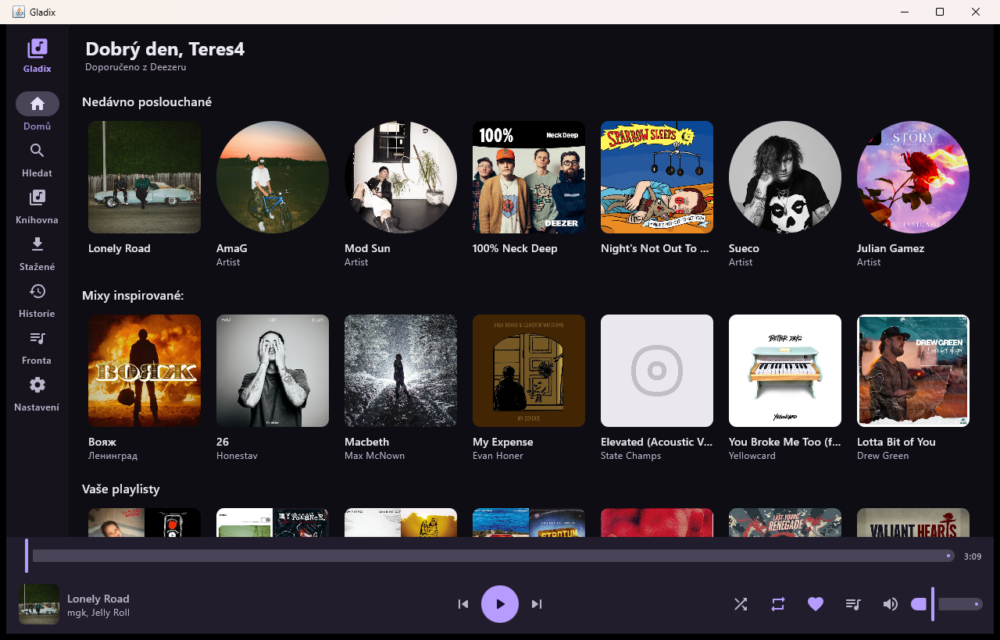
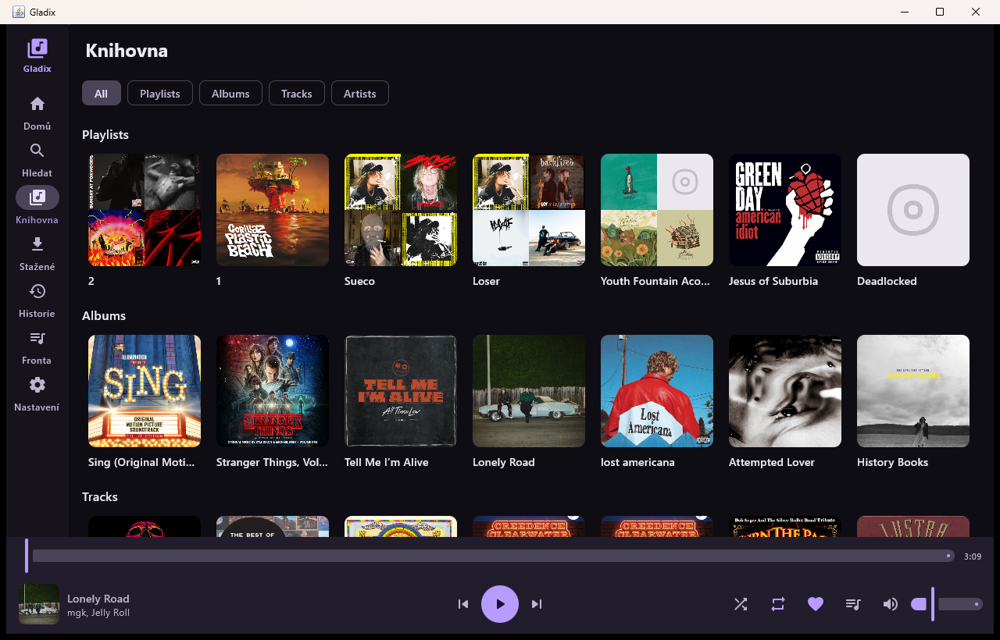
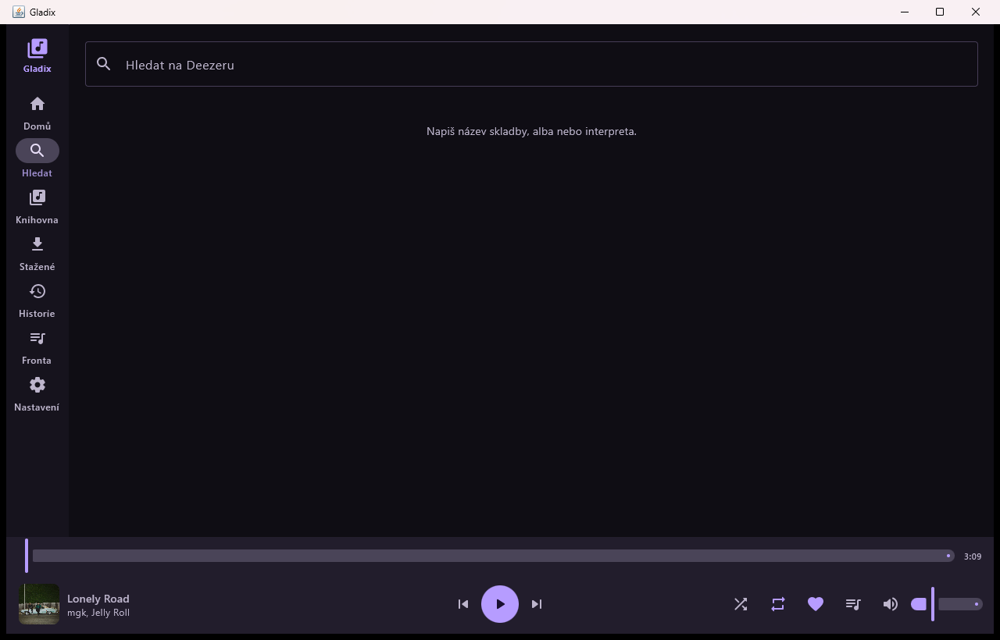
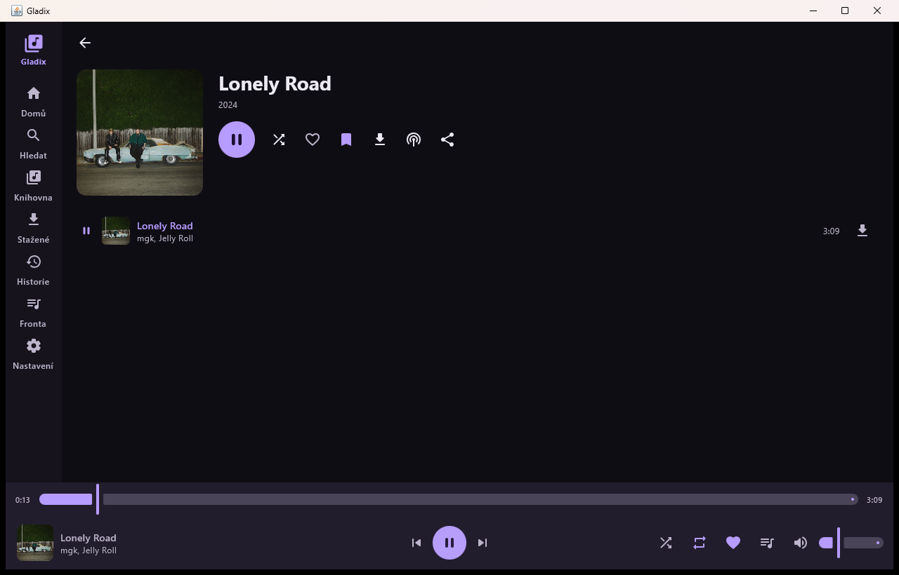
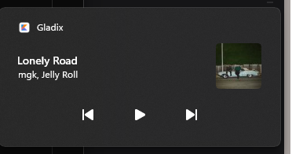
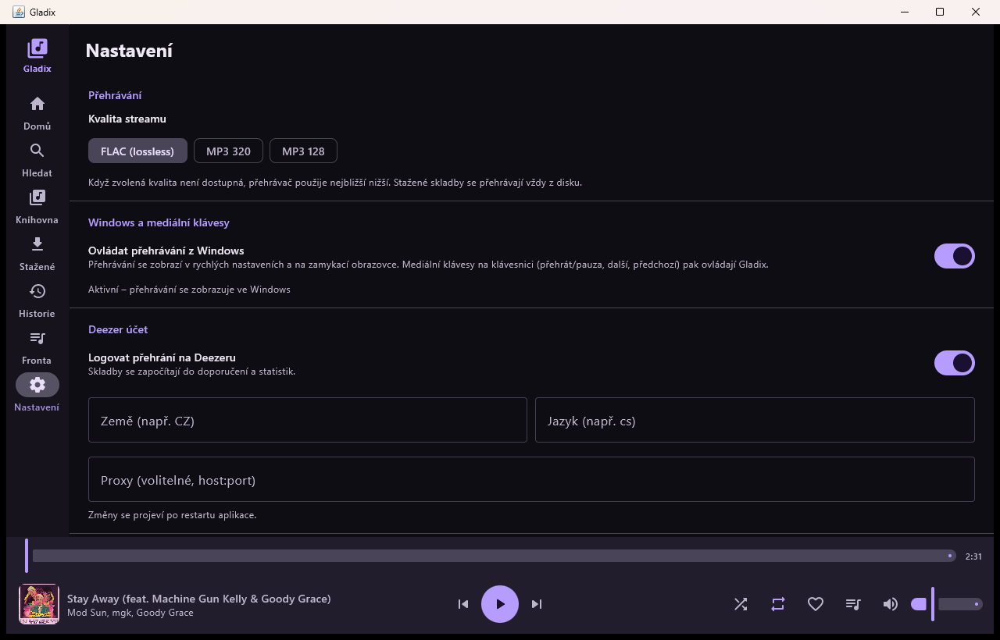

# Gladix Desktop

Windows (desktop) port of [Gladix](https://github.com/rschwertley/gladix) — a Deezer
client. It reuses Gladix's own Kotlin modules for talking to Deezer and replaces the
Android UI with a Compose Desktop UI.

**[Česky](#česky)** · **[English](#english)**

[](https://github.com/FoxxoOwO/gladix-desktop/releases/latest)

**Stažení:** [Gladix-1.1.0-windows-x64.zip](https://github.com/FoxxoOwO/gladix-desktop/releases/latest) — rozbalte a spusťte `Gladix\Gladix.exe`, JDK není potřeba.

**Download:** [Gladix-1.1.0-windows-x64.zip](https://github.com/FoxxoOwO/gladix-desktop/releases/latest) — unzip and run `Gladix\Gladix.exe`, no JDK needed.

---

## Česky

Gladix Desktop je nativní desktopová aplikace pro Windows, která přehrává hudbu z Deezeru.
Nepoužívá prohlížeč ani webové rozhraní — je to klasická Win32 aplikace s vlastním oknem,
která komunikuje přímo s Deezer API přes stejný kód, jaký používá Android verze.
Rozhraní je česky i anglicky, jazyk se přepíná v nastavení.

**Použité moduly z Gladixu (beze změny zdrojového kódu):**

| Modul | Co dělá |
|-------|---------|
| `:common` | Modely (`Track`, `Album`, `Artist`, `Playlist`, `Shelf`…), `Feed`/`PagedData` stránkování, `Settings` rozhraní, `ClientException` |
| `:deezer` | `DeezerExtension`, `DeezerApi`, login (ARL i e-mail/heslo), feedy, vyhledávání, streamy, texty písní, rádio, lajky, knihovna |

Zbytek (UI, přehrávač, stahování, historie, fronta, nastavení) je nový desktopový kód.

### Ukázky

| Domů | Knihovna |
|------|----------|
|  |  |

| Hledání | Album s přehráváním |
|---------|---------------------|
|  |  |

Widget přehrávání v rychlých nastaveních Windows:



Nastavení s přepínačem Windows integrace:



### Funkce

| Funkce | Stav |
|--------|------|
| Přihlášení ARL cookie | ✅ |
| Přihlášení e-mailem a heslem | ✅ |
| Uložení přihlášení mezi spuštěními | ✅ |
| Jazyk rozhraní: čeština a angličtina (přepínač v nastavení) | ✅ |
| Domovská stránka (doporučené feedy s taby) | ✅ |
| Vyhledávání skladeb, alb, interpretů, playlistů | ✅ |
| Historie hledání | ✅ |
| Knihovna (feedy) | ✅ |
| Detail alba / interpreta / playlistu | ✅ |
| Kontextové menu skladby (přehrát, další, fronta, knihovna, lajky, playlist, stahování, interpret, album, rádio, sdílení) | ✅ |
| Ukládání skladby do playlistu (i vytvoření nového playlistu) | ✅ |
| Ukazatel skutečné kvality přehrávaného streamu (např. `FLAC · 44.1 kHz · 2ch`) | ✅ měřeno dekodérem, ne nastavením |
| Obrazovka Přehrává se: velký obal, ovládání, taby Následuje / Text písně / Informace | ✅ |
| Řazení a filtr seznamu skladeb (název, délka, interpret, album, opačně) s volitelným uložením | ✅ |
| Rádio z alba, interpreta, playlistu, skladby | ✅ |
| Přehrávání — volba kvality FLAC / 320 / 128 | ✅ automatický pokles na dostupnou |
| Přehrávač: play/pause, další/předchozí, seek, hlasitost | ✅ |
| Náhodné přehrávání a opakování (off / vše / jedna) | ✅ |
| Fronta přehrávání s přesouváním a mazáním, uložená mezi spuštěními | ✅ |
| Historie přehrávání (posledních 250 skladeb) | ✅ |
| Stahování skladeb na disk (FLAC i MP3) | ✅ |
| Stahování celého alba / playlistu jedním klikem | ✅ |
| Přehrávání stažených souborů z disku | ✅ |
| Texty písní | ✅ |
| Lajky, ukládání do knihovny, sledování interpretů | ✅ |
| Sdílení odkazu (do schránky) | ✅ |
| Nastavení: kvalita, země, jazyk, proxy, Deezer logging | ✅ |
| Ovládání mediálními klávesami (přehrát/pauza, další, předchozí) | ✅ přes Windows SMTC |
| Přehrávání v rychlých nastaveních Windows (název, interpret, obal, seek) | ✅ |
| Světlý/tmavý režim | ⚠️ jen tmavý (téma je připravené) |
| Android Auto, Android TV, Chromecast | ❌ neportsovatelné |
| Lokální soubory mimo Deezer | ❌ mimo rozsah |
| Plugin systém pro jiné rozšíření | ❌ Deezer je zabudovaný |

### Ikona

Ikona se negeneruje ručně v grafickém editoru, ale kódem — `desktop/icons/IconGenerator.java`
(AWT, bez závislostí) kreslí fialovou dlaždici s notou a zapisuje:

| Soubor | K čemu |
|--------|--------|
| `desktop/icons/icon.ico` | vícesize ikona (16–256 px) pro `Gladix.exe`, MSI/EXE instalátor i zástupce |
| `desktop/icons/icon-256.png`, `icon-512.png` | PNG pro README, store a dokumentaci |
| `desktop/icons/icon-preview.png` | kontrola čitelnosti v malých velikostech |
| `desktop/src/main/resources/icon.png` | ikona okna a taskbaru (zabalená v jaru) |

Přegenerování po změně kresby:

```bat
java desktop\icons\IconGenerator.java
```

### Ověřeno

- `gradlew.bat :desktop:selfCheck` — všechny kontroly procházejí (serializace, nastavení,
  žebříček kvalit, dekódování MP3 i FLAC z `testdata/`, řazení seznamů, popisek měřené
  kvality streamu).
- `gradlew.bat :desktop:uiSmoke` — projde všech 9 obrazovek, sheet řazení, kontextové
  menu skladby i dialog ukládání do playlistu v reálném okně a skončí s kódem 0.
- Sestavení a spuštění z `Gladix.exe` bez chyb a bez varování v logu.
- Přihlášení reálným Deezer účtem, načtení domovského feedu (recently played, mixy,
  playlisty, Flow, doporučení), knihovny a detailu alba.
- Přehrávání reálného streamu: pozice se posouvá v reálném čase (0:05 → 0:13),
  ovládání play/pause reaguje v přehrávacím pruhu i v hlavičce.
- Windows integrace: přehrávání se objeví v rychlých nastaveních (Win+A) s názvem
  skladby, interpretem, obalem alba a tlačítky ⏮ ▶/⏸ ⏭; mediální klávesy na
  klávesnici skutečně přepínají přehrávání (ověřeno vložením VK_MEDIA_PLAY_PAUSE,
  VK_MEDIA_NEXT_TRACK a VK_MEDIA_PREV_TRACK — stav se v shellu změnil na Playing
  a pozice se rozjela).

Co ověřeno **není**: stažení celého alba, texty písní a rádio byly napsány proti
stejnému API jako zbytek, ale neprošly ruční zkouškou s živým účtem.

### Požadavky

- Windows 10/11 (x64)
- JDK 17 nebo novější pro sestavení (testováno na JDK 24; aplikace samotná si nese vlastní runtime)

### Sestavení a spuštění

```bat
gradlew.bat :desktop:run
```

### Testy

```bat
gradlew.bat :desktop:selfCheck
```

`selfCheck` je headless sada kontrol, které nepotřebují Deezer účet: serializace
ukládaných modelů, nastavení, žebříček kvalit, dekódování reálného MP3 a FLAC souboru
(`testdata/`), převod na PCM pro zvukovou kartu, řazení seznamů a popisek měřené
kvality streamu.

```bat
gradlew.bat :desktop:uiSmoke
```

`uiSmoke` otevře reálné okno a projde postupně všechny obrazovky (Domů, Hledání,
Knihovna, Stažené, Historie, Fronta, Nastavení, Přehrává se, detail alba) a navíc
sheet řazení, kontextové menu skladby a dialog ukládání do playlistu. Když některý
composable spadne, skončí nenulovým kódem - to odhalí chyby, které `selfCheck`
nevidí (ikona, scope `weight`, chybějící řetězec). Účet nepotřebuje.

### Sestavení Windows aplikace

```bat
gradlew.bat :desktop:createDistributable
```

Výsledek: `desktop\build\compose\binaries\main\app\Gladix\Gladix.exe` — samostatná
složka s vlastním JVM runtime, běží bez instalace JDK. Pro distribuci zabalte tuto
složku do ZIPu (to dělá `release\Gladix-1.1.0-windows-x64.zip`).

Při prvním spuštění si aplikace vytvoří zástupce
`%APPDATA%\Microsoft\Windows\Start Menu\Programs\Gladix.lnk`. Není to nepořádek —
bez něj Windows nezobrazí v rychlých nastaveních jméno „Gladix“ ani ikonu
(viz část Jak to funguje).

Instalační MSI/EXE (`packageMsi`, `packageExe`) vyžaduje
[WiX Toolset 3](https://github.com/wixtoolset/wix3/releases) v `PATH` a oprávnění
administrátora při instalaci WiX:

```bat
gradlew.bat :desktop:packageMsi
```

### Kde jsou data

`%APPDATA%\Gladix\`

```
settings.properties   nastavení
user.json             přihlašovací údaje (ARL / e-mail, heslo)
queue.json            fronta přehrávání
history.json          historie přehrávání
downloads.json        seznam stažených skladeb
downloads\            stažené soubory .flac / .mp3
```

Smazáním složky se aplikace vrátí do stavu po instalaci.

### Jak to funguje

**Přihlášení.** `DeezerExtension.onLogin()` vrací `User`, jehož `extras` obsahují
`arl`, `sid`, `token`, `license_token`, `user_id`, `email` a `pass`. Celý objekt se
uloží jako JSON a při startu se předá zpět do `setLoginUser()`, takže se relace obnoví
bez opakovaného zadávání údajů.

**Přehrávání.** Extension vrací `Streamable.Source.Raw`, jehož `InputProvider.provide()`
dává už **dešifrovaný** proud bytů (Deezer posílá data zašifrovaná Blowfishem, `:deezer`
modul to řeší sám). Desktop tedy nepotřebuje lokální HTTP proxy — čte proud přímo a
krmí jím zvukový dekodér.

**Dekódování.** MP3 a FLAC přes javax.sound s providery `mp3spi` a `jflac-codec`.
Důležité: `AudioSystem.getAudioInputStream(InputStream)` se **nepoužívá** pro detekci
formátu, protože FLAC reader je zkoušen první a na MP3 souboru vyhodí `IOException`
místo `UnsupportedAudioFileException` — tím by selhalo každé MP3. Místo toho se podle
hlavičky souboru (`fLaC`, `RIFF`, `ID3`, MPEG sync) vybere konkrétní reader přímo
(`core/player/Decoders.kt`).

**Seek.** Stream se otevře znovu od začátku a dekódované vzorky se zahazují až do
požadované pozice. Je to pomalejší než byte-range seek, ale jediné správné řešení pro
FLAC (který nemá obnovovací body uprostřed souboru) a pro MP3 bez znalosti bitrate.

**Stahování.** Stahuje se stejný dešifrovaný proud jako při přehrávání, do souboru
`<id>.part`, a po dokončení se podle hlavičky přejmenuje na `.flac` / `.mp3` / `.wav`.

**Ukazatel kvality.** Nastavení kvality je jen přání: Deezer u skladby, která ve FLAC
nevyšla, vrátí MP3, a `DeezerClient` proto zkouší 9 → 6 → 3 → 0, dokud něco nepřijde.
Pill v přehrávači ukazuje, co **skutečně** přišlo — `Decoders.open()` vrátí kromě PCM
proudu i rozpoznaný kontejner a formát, `PlayerController.streamQuality` to vystaví a
`StreamQuality.label` z toho složí text jako `FLAC · 44.1 kHz · 2ch`. Před přepnutím
skladby se hodnota vynuluje, aby na obrazovce nikdy nezůstala kvalita té předchozí.

**Windows a mediální klávesy.** Přehrávač publikuje stav do System Media Transport
Controls (SMTC) přes knihovnu `JavaMediaTransportControls`; z toho žije widget v
rychlých nastaveních i směrování hardwarových mediálních kláves — vlastní hook na
klávesnici není potřeba a ani se nepoužívá (jinak by klávesa přišla dvakrát).
Dvě věci jsou háklivé:

1. `SetCurrentProcessExplicitAppUserModelID` je **wide** API. Když se mu předá
   obyčejný `String`, JNA ho zkonvertuje na ANSI bajty a shell je přečte jako UTF-16,
   takže id vznikne jako nesmysl. Proto se předává `WString`.
2. Id se ve shellu přeloží na jméno a ikonu jen tehdy, když ho nese **zástupce
   v nabídce Start** jako vlastnost `System.AppUserModel.ID`. Zápis do registru
   `HKCU\Software\Classes\AppUserModelId` na widget v rychlých nastaveních nestačí.
   Proto aplikace při prvním spuštění sama vytvoří `Gladix.lnk` (přes `IShellLink`,
   `IPropertyStore` a `IPersistFile` z JNA) — portable build totiž žádný instalátor,
   který by to udělal, nemá.

Obal alba se do SMTC nedá předat přímo: obal knihovny předává nativní části `file:`
URI, kterou `StorageFile::GetFileFromPathAsync` neotevře, a navíc na výsledek čeká bez
časového limitu. Proto se obal stáhne do `%APPDATA%\Gladix\images` a do nativní vrstvy
se předá přes reflextí získaný adaptér se skutečnou cestou a s timeoutem.

### Struktura

```
common/    převzato z Gladixu, beze změny
deezer/    převzato z Gladixu, beze změny
desktop/
  icons/
    IconGenerator.java   generátor ikony (ICO + PNG), viz část Ikona
  src/main/kotlin/dev/gladix/desktop/
    Main.kt              vstupní bod, okno
    SelfCheck.kt         headless testy
    UiSmoke.kt           projde všechny obrazovky v reálném okně
    AppContext.kt        sdílené závislosti
    core/
      Prefs.kt           cesty, nastavení, JSON
      Images.kt          načítání a cache obrázků
      DeezerClient.kt    obal nad DeezerExtension
      Downloads.kt       stahování na disk
      History.kt         historie přehrávání
      player/
        Decoders.kt      detekce kontejneru a převod na PCM
        StreamQuality.kt naměřený formát streamu pro ukazatel kvality
        AudioEngine.kt   výstup na zvukovou kartu
        PlayerController.kt  fronta, opakování, náhoda
      platform/
        AppIdentity.kt         AppUserModelID a zástupce v nabídce Start
        WindowsMediaSession.kt SMTC – rychlá nastavení a mediální klávesy
        SystemMediaSink.kt     rozhraní, prázdná implementace pro jiné OS
    ui/                  Compose obrazovky
      text/Strings.kt    všechny texty rozhraní (cs + en)
      NowPlayingScreen.kt  velký přehrávač s taby Následuje / Text / Informace
      TrackMenu.kt       kontextové menu skladby a ukládání do playlistu
      Sort.kt            logika řazení a její uložení
      SortSheet.kt       sheet Řazení a filtr
testdata/                vzorky pro selfCheck
```

### Licence

Zdrojový kód Gladixu i tohoto portu je pod
[Unabandon Public License](LICENSE.md) (GPLv3 rozšířená o povinnost zveřejnit zdrojový
kód odvozených děl). Pokud aplikaci distribuujete, musíte zpřístupnit zdrojový kód.

Postaveno na [Echo](https://github.com/brahmkshatriya/echo) od brahmkshatriya a na
[Gladix](https://github.com/rschwertley/gladix) od rschwertley. Deezer je ochranná
známka Deezer SA; tento projekt s ní není nijak spojen.

---

## English

Gladix Desktop is a native Windows desktop app that plays music from Deezer. There is
no browser or web view involved: it is a regular Win32 application with its own window
that talks to the Deezer API through the very same code the Android version uses. The
interface ships in Czech and English, switchable in Settings.

**Modules taken from Gladix (sources unchanged):**

| Module | What it does |
|--------|--------------|
| `:common` | Models (`Track`, `Album`, `Artist`, `Playlist`, `Shelf`…), `Feed`/`PagedData` pagination, the `Settings` interface, `ClientException` |
| `:deezer` | `DeezerExtension`, `DeezerApi`, login (ARL and e-mail/password), feeds, search, streams, lyrics, radio, likes, library |

Everything else (UI, player, downloads, history, queue, settings) is new desktop code.

### Screenshots

(The screenshots show the Czech UI; the interface text is fully translated.)

| Home | Library |
|------|---------|
|  |  |

| Search | Album while playing |
|--------|---------------------|
|  |  |

Playback widget in Windows quick settings:


Settings with the Windows integration toggle:


### Features

| Feature | Status |
|---------|--------|
| Login with an ARL cookie | ✅ |
| Login with e-mail and password | ✅ |
| Login persisted between launches | ✅ |
| UI language: Czech and English (switcher in Settings) | ✅ |
| Home screen (recommended feeds with tabs) | ✅ |
| Search for tracks, albums, artists, playlists | ✅ |
| Search history | ✅ |
| Library (feeds) | ✅ |
| Album / artist / playlist detail | ✅ |
| Track context menu (play, next, queue, library, likes, playlist, download, artist, album, radio, share) | ✅ |
| Saving a track to a playlist (including creating a new one) | ✅ |
| Real quality of the stream that is playing (e.g. `FLAC · 44.1 kHz · 2ch`) | ✅ measured by the decoder, not by the setting |
| Now playing screen: large artwork, transport, Up Next / Lyrics / Info tabs | ✅ |
| Sorting and filtering a track list (title, duration, artist, album, reversed) with an optional save | ✅ |
| Radio from an album, artist, playlist or track | ✅ |
| Playback — quality FLAC / 320 / 128 | ✅ falls back to the best available |
| Player: play/pause, next/previous, seek, volume | ✅ |
| Shuffle and repeat (off / all / one) | ✅ |
| Playback queue with reordering and removal, saved between launches | ✅ |
| Playback history (last 250 tracks) | ✅ |
| Downloading tracks to disk (FLAC and MP3) | ✅ |
| Downloading a whole album / playlist in one click | ✅ |
| Playing downloaded files from disk | ✅ |
| Lyrics | ✅ |
| Likes, saving to library, following artists | ✅ |
| Sharing a link (to the clipboard) | ✅ |
| Settings: quality, country, language, proxy, Deezer scrobbling | ✅ |
| Media keys (play/pause, next, previous) | ✅ through Windows SMTC |
| Playback in Windows quick settings (title, artist, artwork, seek) | ✅ |
| Light/dark mode | ⚠️ dark only (the theme is prepared) |
| Android Auto, Android TV, Chromecast | ❌ not portable |
| Local files outside Deezer | ❌ out of scope |
| Plugin system for other extensions | ❌ Deezer is built in |

### Icon

The icon is not drawn by hand in a graphics editor but by code —
`desktop/icons/IconGenerator.java` (plain AWT, no dependencies) paints the violet tile
with a note and writes:

| File | Purpose |
|------|---------|
| `desktop/icons/icon.ico` | multi-size icon (16–256 px) for `Gladix.exe`, the MSI/EXE installer and the shortcut |
| `desktop/icons/icon-256.png`, `icon-512.png` | PNG for the README, a store listing and docs |
| `desktop/icons/icon-preview.png` | legibility check at small sizes |
| `desktop/src/main/resources/icon.png` | window and taskbar icon (baked into the jar) |

Regenerate after changing the artwork:

```bat
java desktop\icons\IconGenerator.java
```

### Verified

- `gradlew.bat :desktop:selfCheck` — every check passes (serialization, settings,
  the quality ladder, decoding of the real MP3 and FLAC samples in `testdata/`, list
  sorting, the measured stream-quality label).
- `gradlew.bat :desktop:uiSmoke` — walks all 9 screens, the sort sheet, the track context
  menu and the save-to-playlist dialog in a real window and exits with code 0.
- Built and started from `Gladix.exe` with no errors and no warnings in the log.
- Signed in with a real Deezer account, home feed loaded (recently played, mixes,
  playlists, Flow, recommendations), library and album details as well.
- Real stream playback: the position advances in real time (0:05 → 0:13), and
  play/pause reacts both in the player bar and in the header.
- Windows integration: playback shows up in quick settings (Win+A) with track title,
  artist, album art and ⏮ ▶/⏸ ⏭ buttons; media keys really toggle playback (verified
  by injecting VK_MEDIA_PLAY_PAUSE, VK_MEDIA_NEXT_TRACK and VK_MEDIA_PREV_TRACK — the
  shell state flipped to Playing and the position moved).

What is **not** verified: downloading a whole album, lyrics and radio were written
against the same API as the rest, but have not been exercised by hand with a live
account.

### Requirements

- Windows 10/11 (x64)
- JDK 17 or newer to build (tested on JDK 24; the app itself bundles its own runtime)

### Build and run

```bat
gradlew.bat :desktop:run
```

### Tests

```bat
gradlew.bat :desktop:selfCheck
```

`selfCheck` is a headless suite that needs no Deezer account: serialization of stored
models, settings, the quality ladder, decoding of a real MP3 and FLAC file
(`testdata/`), conversion to PCM for the sound card, list sorting and the measured
stream-quality label.

```bat
gradlew.bat :desktop:uiSmoke
```

`uiSmoke` opens a real window and walks every screen in turn (Home, Search, Library,
Downloads, History, Queue, Settings, Now playing, album detail) plus the sort sheet,
the track context menu and the save-to-playlist dialog. If a composable throws, it
exits non-zero - that catches what `selfCheck` cannot see (a wrong icon, a `weight`
in the wrong scope, a missing string). It needs no account.

### Building the Windows app

```bat
gradlew.bat :desktop:createDistributable
```

Result: `desktop\build\compose\binaries\main\app\Gladix\Gladix.exe` — a self-contained
folder with its own JVM runtime, so no JDK installation is needed. For distribution,
zip that folder (which is what `release\Gladix-1.1.0-windows-x64.zip` does).

On first launch the app creates a shortcut at
`%APPDATA%\Microsoft\Windows\Start Menu\Programs\Gladix.lnk`. That is not clutter:
without it Windows will not show the name "Gladix" or the icon in quick settings
(see the How it works section).

The MSI/EXE installers (`packageMsi`, `packageExe`) need
[WiX Toolset 3](https://github.com/wixtoolset/wix3/releases) on `PATH` and administrator
rights while WiX is installed:

```bat
gradlew.bat :desktop:packageMsi
```

### Where the data lives

`%APPDATA%\Gladix\`

```
settings.properties   settings
user.json             credentials (ARL / e-mail, password)
queue.json            playback queue
history.json          playback history
downloads.json        list of downloaded tracks
downloads\            downloaded .flac / .mp3 files
```

Deleting the folder returns the app to its freshly installed state.

### How it works

**Login.** `DeezerExtension.onLogin()` returns a `User` whose `extras` carry `arl`,
`sid`, `token`, `license_token`, `user_id`, `email` and `pass`. The whole object is
stored as JSON and handed back to `setLoginUser()` on startup, so the session is
restored without asking for credentials again.

**Playback.** The extension returns a `Streamable.Source.Raw` whose
`InputProvider.provide()` already yields a **decrypted** byte stream (Deezer encrypts
with Blowfish; the `:deezer` module handles it). The desktop app therefore needs no
local HTTP proxy — it reads the stream directly and feeds the audio decoder.

**Decoding.** MP3 and FLAC through javax.sound with the `mp3spi` and `jflac-codec`
providers. Important: `AudioSystem.getAudioInputStream(InputStream)` is **not** used
for format detection, because the FLAC reader is probed first and throws `IOException`
(not `UnsupportedAudioFileException`) on an MP3, which would break every MP3. Instead
the container is sniffed from the file header (`fLaC`, `RIFF`, `ID3`, MPEG sync) and
the matching reader is called directly (`core/player/Decoders.kt`).

**Seek.** The stream is reopened from the start and decoded samples are dropped until
the target position. Slower than a byte-range seek, but the only correct approach for
FLAC (which has no middle-of-file resync points) and for MP3 without knowing the
bitrate.

**Downloads.** The same decrypted stream as playback is written to `<id>.part` and
renamed to `.flac` / `.mp3` / `.wav` once complete, based on the header.

**Quality pill.** The quality setting is only a wish: for a track that was never
released as FLAC, Deezer answers with MP3, so `DeezerClient` tries 9 → 6 → 3 → 0 until
something arrives. The pill in the player shows what **actually** arrived —
`Decoders.open()` returns the recognised container and format next to the PCM stream,
`PlayerController.streamQuality` exposes it and `StreamQuality.label` builds a text such
as `FLAC · 44.1 kHz · 2ch`. The value is cleared before a new track starts, so the
previous track's quality is never left on screen.

**Windows and media keys.** The player publishes state to the System Media Transport
Controls (SMTC) through `JavaMediaTransportControls`; the quick settings widget and
the routing of hardware media keys both come from it — a custom keyboard hook is
neither needed nor used (it would deliver every key twice). Two things are delicate:

1. `SetCurrentProcessExplicitAppUserModelID` is a **wide** API. Passing a plain
   `String` makes JNA convert it to ANSI bytes, which the shell then reads as UTF-16,
   producing a garbage id. Hence `WString`.
2. The shell only maps that id to a name and icon when a **Start menu shortcut**
   carries it as the `System.AppUserModel.ID` property. Writing to
   `HKCU\Software\Classes\AppUserModelId` is not enough for the quick settings widget.
   That is why the app creates `Gladix.lnk` itself on first launch (through
   `IShellLink`, `IPropertyStore` and `IPersistFile` from JNA) — a portable build has
   no installer to do it.

Album art cannot be handed to SMTC directly: the library passes a `file:` URI to the
native side, which `StorageFile::GetFileFromPathAsync` will not open, and it then waits
for the result without a timeout. The art is therefore downloaded into
`%APPDATA%\Gladix\images` and given to the native layer through a reflectively obtained
adapter that uses a real path and a timeout.

### Layout

```
common/    taken from Gladix, unchanged
deezer/    taken from Gladix, unchanged
desktop/
  icons/
    IconGenerator.java   icon generator (ICO + PNG), see the Icon section
  src/main/kotlin/dev/gladix/desktop/
    Main.kt              entry point, window
    SelfCheck.kt         headless tests
    UiSmoke.kt           walks every screen in a real window
    AppContext.kt        shared dependencies
    core/
      Prefs.kt           paths, settings, JSON
      Images.kt          image loading and cache
      DeezerClient.kt    wrapper around DeezerExtension
      Downloads.kt       downloading to disk
      History.kt         playback history
      player/
        Decoders.kt      container detection and PCM conversion
        StreamQuality.kt measured stream format for the quality pill
        AudioEngine.kt   output to the sound card
        PlayerController.kt  queue, repeat, shuffle
      platform/
        AppIdentity.kt         AppUserModelID and the Start menu shortcut
        WindowsMediaSession.kt SMTC – quick settings and media keys
        SystemMediaSink.kt     interface, no-op implementation for other OSes
    ui/                  Compose screens
      text/Strings.kt    every UI string (cs + en)
      NowPlayingScreen.kt  large player with Up Next / Lyrics / Info tabs
      TrackMenu.kt       track context menu and save-to-playlist
      Sort.kt            sort logic and how it is persisted
      SortSheet.kt       the sort and filter sheet
testdata/                samples for selfCheck
```

### License

The Gladix sources and this port are under the
[Unabandon Public License](LICENSE.md) (GPLv3 extended with the obligation to publish
the source of derivative works). If you distribute the app, you must make the source
available.

Built on [Echo](https://github.com/brahmkshatriya/echo) by brahmkshatriya and on
[Gladix](https://github.com/rschwertley/gladix) by rschwertley. Deezer is a trademark
of Deezer SA; this project is not affiliated with it.